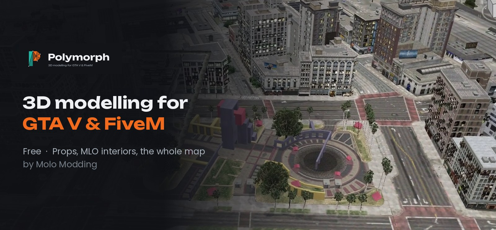
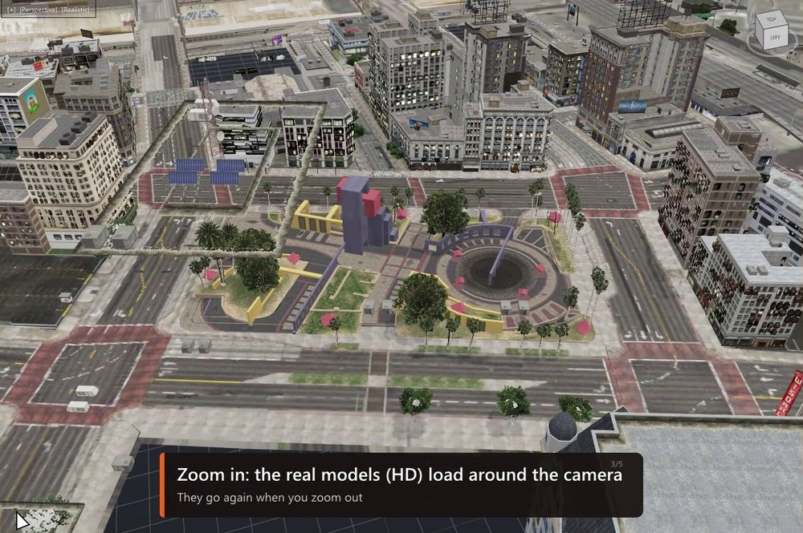
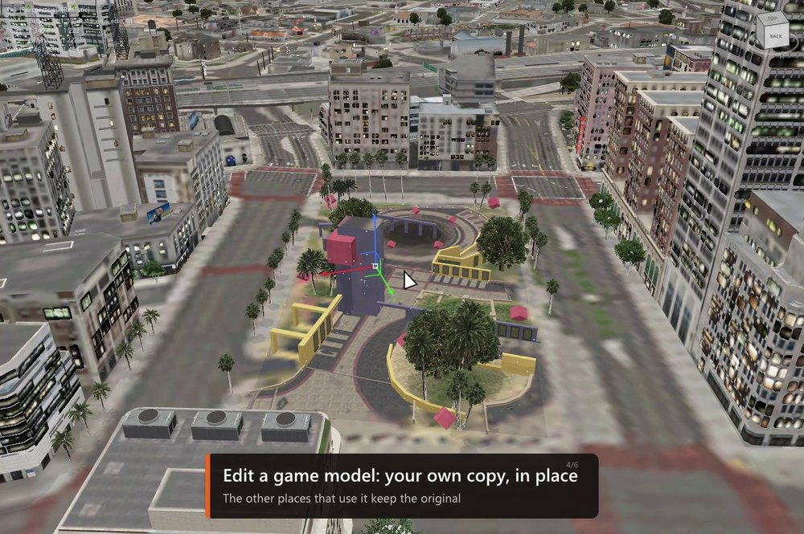
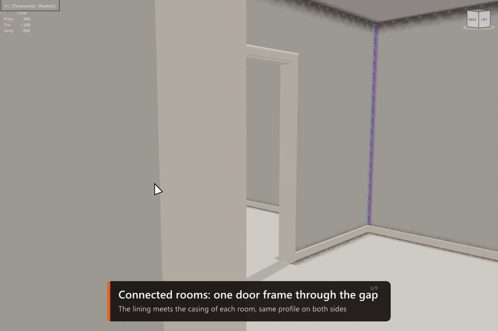
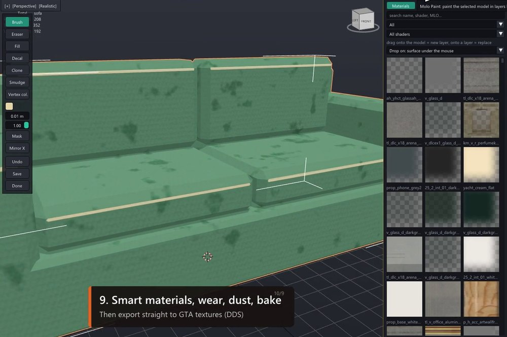
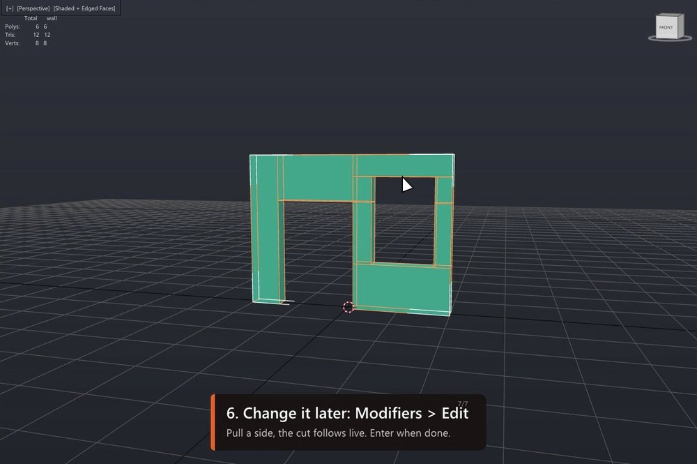
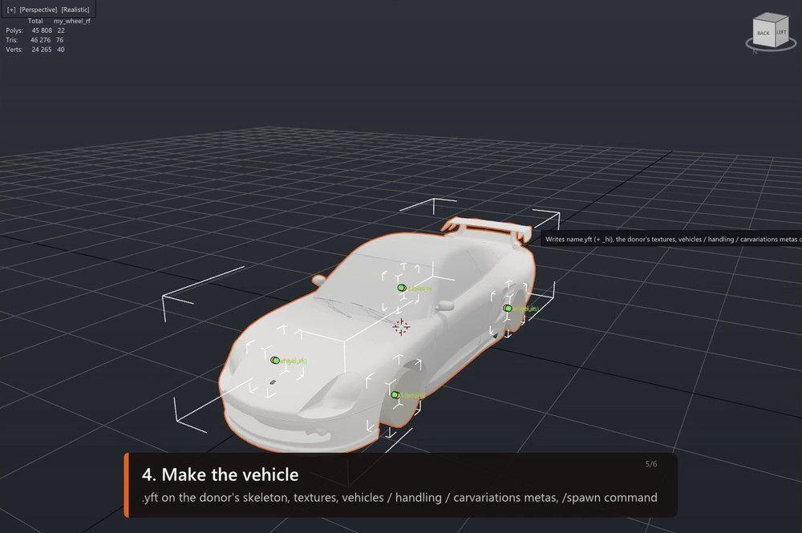

<p align="center">
  
</p>

<p align="center">
  <a href="https://molossen.github.io/polymorph/Polymorph-Setup-1.3.1.exe"><b>⬇ Download for Windows (free)</b></a>
  &nbsp;·&nbsp;
  <a href="https://molossen.github.io/polymorph/">Website</a>
  &nbsp;·&nbsp;
  <a href="https://molossen.github.io/polymorph/#tutorials">18 video tutorials</a>
  &nbsp;·&nbsp;
  <a href="https://discord.com/invite/molomodding">Discord</a>
</p>

# Polymorph

**The 3D editor made for GTA V and FiveM creators.** Model a prop, build an MLO interior or edit the real map,
then export a FiveM resource that is ready to `ensure` — in one free program, without the usual chain of
3ds Max + GIMS, Blender + Sollumz and CodeWalker.

- **Modelling you already know** — the modifier stack and the snaps of 3ds Max, the speed and shortcuts of Blender.
- **GTA built in** — the game's shaders, `.ydr .yft .ybn .ytyp .ymap` in and out, a checker that fixes what would crash in game.
- **The whole map in the viewport** — like CodeWalker, with real models streaming around the camera, and every modelling tool working on it.
- **Free forever**, for personal and commercial work. What you make is yours.

## See it

| | |
|---|---|
|  **MAP mode** — the whole GTA V map, HD models around the camera |  **Edit the map** — game models become your own copy, in place |
|  **MLO Room Builder** — draw the plan, closed rooms, portals and door frames follow |  **Sculpt & Paint** — smart materials, wear and dust, export to GTA textures |
|  **Wall Opening** — trace a door or a window on any wall, no boolean |  **Vehicle Forge** — any car model becomes a FiveM vehicle |

## Learn it — 18 short videos

Recorded in the app itself, real clicks and keys. Watch the tour, then go part by part.

| Part | Videos |
|---|---|
| **1 · Discover** | [01 The tour](https://molossen.github.io/polymorph/tuto/01_the_tour.mp4) — the best of 3ds Max, Blender and the GTA V tools in one app |
| **2 · The basics** | [02 Navigation](https://molossen.github.io/polymorph/tuto/02_navigation.mp4) · [03 Modeling](https://molossen.github.io/polymorph/tuto/03_modeling.mp4) · [04 Snaps](https://molossen.github.io/polymorph/tuto/04_snaps.mp4) · [05 Edit mode tricks](https://molossen.github.io/polymorph/tuto/05_edit_mode_tricks.mp4) |
| **3 · Shape faster** | [06 Boolean](https://molossen.github.io/polymorph/tuto/06_boolean.mp4) · [07 Wall Opening](https://molossen.github.io/polymorph/tuto/07_wall_opening.mp4) · [08 Modifiers](https://molossen.github.io/polymorph/tuto/08_modifiers.mp4) |
| **4 · Surface** | [09 Materials & UVs](https://molossen.github.io/polymorph/tuto/09_materials_uvs.mp4) · [10 Sculpt & Paint](https://molossen.github.io/polymorph/tuto/10_sculpt_paint.mp4) · [11 Animation](https://molossen.github.io/polymorph/tuto/11_animation.mp4) |
| **5 · GTA V & FiveM** | [12 GTA lights](https://molossen.github.io/polymorph/tuto/12_gta_lights.mp4) · [13 MLO Room Builder](https://molossen.github.io/polymorph/tuto/13_mlo_room_builder.mp4) · [14 MAP mode](https://molossen.github.io/polymorph/tuto/14_map_mode.mp4) · [15 Modeling on the map](https://molossen.github.io/polymorph/tuto/15_modeling_on_the_map.mp4) · [16 Weapon Forge](https://molossen.github.io/polymorph/tuto/16_weapon_forge.mp4) · [17 Vehicle Forge](https://molossen.github.io/polymorph/tuto/17_vehicle_forge.mp4) · [18 The GTA panel](https://molossen.github.io/polymorph/tuto/18_the_gta_panel.mp4) |

All of them, with chapters, on the [website](https://molossen.github.io/polymorph/#tutorials).

## What's inside

**Modelling**
- Edit Poly and Unwrap UVW as non-destructive modifiers, plus Array, Mirror, Solidify, Subdivision, Weld, Displace, Smooth…
- Extrude, inset, bevel, chamfer, bridge, knife, loop cut, connect; booleans that leave clean topology.
- **Wall Opening**: drag a rectangle on a wall, pull the sides, Enter. Rect, arch or round, any number of segments; stays editable.
- Shift + move copies faces or pulls new faces out of edges; drop a vertex exactly on another one; material pipette.
- Vertex, edge and face snaps with visible targets: corner on corner, face against face.
- Game-style fly camera (right button + ZQSD / WASD) and a view cube you can drag.

**Surface**
- GTA shaders, drag & drop materials, Smart UV, Lightmap Pack, Cube / Cylinder / Sphere / From View projections.
- Sculpt brushes; painting with layers, masks and smart materials, high-to-low bake, export to DDS / PNG / TGA.
- Animation timeline with auto key, texture scroll and camera keys, written as a GTA `.ycd`.

**GTA V & FiveM**
- Import and export `.ydr .yft .ydd .ybn .ytyp .ymap`; textures embedded or in a `.ytd`.
- GTA checker with one-click fixes (shell in limbo, collision on the shell, vertex colours, sizes…).
- **MLO Room Builder**: rooms, portals, doors, windows, frames, skirting and dirt, with live 3D.
- **GTA lights**: point, spot and capsule with every game field, written the way Sollumz reads them.
- **MAP mode**: the whole map with its levels of detail, real models loading around the camera; move, delete and place props,
  edit game interiors, model right on the map, save everything as one FiveM resource.
- **Weapon Forge** and **Vehicle Forge**: a game weapon or car lends its skeleton, your model is fitted on it, the metas are written.
- One key (F10) exports a FiveM resource with its `fxmanifest.lua`; it can be sent to your test server and restarted.

**Built to hold up** — every release runs 276 automatic tests, plus random "chaos" runs: thousands of modelling operations,
GTA and `.glb` export round trips, and thousands of random clicks and keys in the real window.

## AI 3D models with Tripo

Polymorph has Tripo built in (Tripo tab): a picture or a sentence becomes a prop at GTA scale, ready to retouch and export.
Get Tripo here: https://tripo.pxf.io/0G7AVP (signing up with this link supports Polymorph, which stays free).

## Install

1. [Download the installer](https://molossen.github.io/polymorph/Polymorph-Setup-1.3.1.exe) and run it (no admin rights needed).
2. Start Polymorph from the Start menu or the desktop shortcut.
3. Updates: when a new version is out, a green **Update** button shows in the menu bar. One click downloads it,
   installs it over your copy and restarts Polymorph — your settings, keys and library are kept (Help > Check for updates).

Prefer no installer? The same app as a [zip](https://molossen.github.io/polymorph/Polymorph-1.3.1-win-x64.zip): unzip anywhere and run `Polymorph.exe`.

Needs Windows 10 / 11 64-bit and a DirectX 11 graphics card. For the game files, your own copy of GTA V:
Polymorph reads your install and ships no game file.

What changed in each version: [CHANGELOG.md](CHANGELOG.md).

## Build from source

Requires the [.NET 8 SDK](https://dotnet.microsoft.com/download/dotnet/8.0).

```
build.bat      :: core tests, build into out\ and start out\Polymorph.exe
release.bat    :: self-contained zip in release\
installer\    :: NSIS script for the setup .exe (makensis installer\polymorph.nsi)
```

Scripting: Python runs inside Polymorph like `bpy` in Blender (`import poly`, add-ons, a script editor), plus an MCP server so Claude can drive it (see `python/README.md`).

## Licence

Free to use, all rights reserved: no resale, no redistribution, no decompiling. See [LICENSE](LICENSE).
Third-party components keep their own licences: see [THIRD-PARTY-NOTICES.txt](THIRD-PARTY-NOTICES.txt).
Grand Theft Auto V belongs to Rockstar Games / Take-Two Interactive; Polymorph is a free community tool, not affiliated with them.
