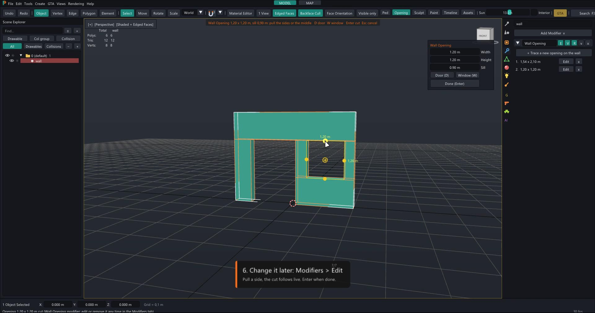

# Polymorph

**Free 3D modelling for GTA V & FiveM — by Molo Modding.**

Polymorph takes the best of **3ds Max** and **Blender** and combines them in one program made for GTA V / FiveM creators:
the modifier stack and the snaps of 3ds Max, the speed and the shortcuts of Blender, and a viewport that renders like the game.
Build props, MLO interiors and whole map edits, then export a FiveM resource that is ready to `ensure`.

**Free forever.** Free to use for your personal and commercial projects; what you make with it is yours. Polymorph itself is not open source: see [LICENSE](LICENSE).

> Version 1.0.0 — see [CHANGELOG.md](CHANGELOG.md). Download the ready-to-run zip from the [Releases](../../releases) page.

## ★ New: Wall Opening — doors and windows in one gesture



Cut doors, windows and passages **straight on the wall** — no cutter object, no boolean to set up:

1. Select the wall, click **Opening** in the toolbar (or right-click the wall > *Cut opening*).
2. **Drag a rectangle** on the wall — a single click makes a 1.20 m window.
3. **Pull any side** (or the middle handle to move it). **D** = door from the floor (2.10 m), **W** = window (sill 0.90 m).
   Exact sizes in the small panel: width, height, sill.
4. **Enter** — the opening is cut through the wall with clean straight faces and the reveal inside. **Esc** cancels.

Every opening stays editable in the **Wall Opening** modifier (Modifiers tab > *Edit*: pull a side, the cut follows live),
can be removed at any time, and is applied for good with *Apply*. Works on thick walls and on MLO room boxes
(the doorway becomes a portal by itself). Undo with Ctrl+Z at every step.

## Tutorials

Short videos, one per topic, attached to the [release page](../../releases/latest) (plus a one-minute trailer):

| | |
|---|---|
| 01 · Modeling | Shift + move copies, pull edges, Bridge, right-click menu |
| 02 · Snaps | Corner to corner, face against face, gizmo arrow stopping on a face |
| 03 · Navigation | Game-style camera (right button + ZQSD / WASD), arrows, view cube |
| 04 · Materials & UVs | New material, drag & drop on objects / faces, UV menu, cube projection |
| 05 · MLO Room Builder | Draw rooms, doors and windows; live 3D, connected rooms with joined door frames, skirting, dirt |
| 06 · GTA lights | Point, spot and capsule lights, exported like Sollumz |
| 07 · MAP mode | The whole GTA V map, LOD levels, HD around the camera, props, FiveM resource |
| 10 · Modeling on the map | A box edited in place, MLO rooms built on the ground, a game model turned into your own copy |
| 11 · Weapon Forge | A model fitted on a game weapon's skeleton, written as an add-on weapon |
| 12 · Vehicle Forge | A car fitted on a game car's wheels, written as a FiveM vehicle |
| 17 · Wall Opening | Trace a door and a window on a wall, pull the sides, Enter, edit later |
| 08 · Best of all | What comes from 3ds Max, Blender and the GTA V tools, side by side |

## What's inside

- **Modeling** — Edit Poly and Unwrap UVW as non-destructive modifiers; **Wall Opening** (doors / windows traced on the wall);
  extrude, inset, bevel, chamfer, bridge, knife, booleans with automatic clean topology;
  Shift + move copies faces or pulls new faces out of edges; sculpt tools to clean generated meshes.
- **Snaps** — vertex, edge and face snaps with visible targets: grab a point of the object and drop it on another one;
  a face snap puts the object against the surface, never inside.
- **Camera** — game-style fly camera (hold the right mouse button, ZQSD / WASD, E / C, Shift, wheel), view cube you can drag.
- **Materials & UVs** — GTA shaders, drag & drop materials, Unwrap, Smart UV, Lightmap Pack, Cube / Cylinder / Sphere / From View projections.
- **GTA / FiveM** — import and export `.ydr .yft .ydd .ybn .ytyp .ymap`; GTA checker with one-click fixes; MLO Room Builder
  (rooms, portals, doors, windows, frames, skirting, dirt) with live 3D; GTA lights (point, spot, capsule) with every game field,
  written the way Sollumz reads them; one-click FiveM resource export.
- **MAP mode** — the whole GTA V map like CodeWalker, levels of detail per checkbox, real models loading around the camera,
  move / delete / place props, edit game interiors, save as a FiveM resource. Model right on the map: every modeling tool,
  the MLO Room Builder on the ground, game models edited in place as your own copy.
- **Weapon Forge** — any 3D model becomes a GTA weapon: a game weapon lends its skeleton (grip, muzzle, attachments), the model is
  fitted on it automatically; replace the game's weapon or write an add-on with its metas cloned from the game.
- **Vehicle Forge** — any car model becomes a FiveM vehicle: its wheels are found, it is fitted on a game car's wheels, and the
  donor's skeleton, wheels, collision and handling carry it (yft, textures, vehicles / handling / carvariations metas).
- **Rendering** — game shader in linear light with a filmic tone curve, sun shadows, 32 scene lights.
- **Scripting** — Python API and MCP server: Claude can drive Polymorph (see `python/README.md`).

## AI 3D models with Tripo

Polymorph has Tripo built in (Tripo tab): a picture or a sentence becomes a prop, at GTA scale, ready to retouch and export.
Get Tripo here: https://tripo.pxf.io/0G7AVP (signing up with this link supports Polymorph, which stays free).

## Requirements

- Windows 10 / 11, 64-bit, a DirectX 11 graphics card.
- Your own copy of GTA V for the game files (Polymorph reads your install, it ships no game file).

## Build from source

Requires the [.NET 8 SDK](https://dotnet.microsoft.com/download/dotnet/8.0).

```
build.bat      :: core tests, build into out\ and start out\Polymorph.exe
release.bat    :: self-contained zip in release\
```

## Licence

Polymorph Licence — free to use, all rights reserved: no resale, no redistribution, no decompiling. See [LICENSE](LICENSE). Third-party components keep their own licences: see [THIRD-PARTY-NOTICES.txt](THIRD-PARTY-NOTICES.txt).
Grand Theft Auto V belongs to Rockstar Games / Take-Two Interactive; Polymorph is a free community tool, not affiliated with them.
